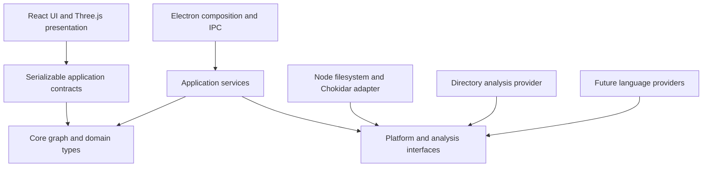

# Manifold project design

Status: initial implementation baseline; revise as implementation produces evidence.
Created: 2026-10-27.

## 1. Purpose and priorities

Manifold presents a directory or codebase as an interactive 3D graph. Users should be able to understand structure, find an entity, inspect its source, and explore its relationships.

Priorities, in order:

1. Faithfully represent the selected source and communicate incomplete or stale information.
2. Preserve boundaries between the domain, operating system, language syntax, and visualization.
3. Make directory navigation useful and predictable.
4. Keep interaction responsive as source size grows.
5. Extend through additional adapters and providers rather than changes throughout the application.

The first release supports Windows and local directory structure. Future support is an architectural objective, not a claim that arbitrary operating systems or languages work without additional implementation.

## 2. Initial technology decisions

| Concern               | Initial choice                                                   | Reason                                                 |
| --------------------- | ---------------------------------------------------------------- | ------------------------------------------------------ |
| Application language  | TypeScript with strict checking                                  | Shared contracts across desktop, workers, and UI       |
| Desktop host          | Electron                                                         | Desktop integration and a consistent Chromium renderer |
| UI                    | React                                                            | Application panels and interaction state               |
| 3D                    | Three.js through React Three Fiber                               | Control over layout, rendering, and interactions       |
| Scene helpers         | Drei, selectively                                                | Camera and scene utilities                             |
| Filesystem            | Node filesystem APIs                                             | Directory traversal and file reads                     |
| Watch notifications   | Chokidar                                                         | Cross-platform event normalization                     |
| Build                 | Vite and Electron Forge, subject to scaffold compatibility check | Development tooling and desktop packaging              |
| Verification          | Vitest; targeted Electron end-to-end tests where needed          | Domain tests and application integration               |
| Future syntax parsing | Tree-sitter, evaluated when adding a language                    | Incremental syntax parsing behind a provider           |

Resolve compatible stable versions at scaffolding time, commit a lockfile, and record the package manager and supported Node version. Do not depend on floating versions in repeatable builds.

Electron has a larger runtime footprint than a system-webview host. This is an accepted initial tradeoff. Rust/Tauri remains an alternative if measured requirements justify reconsideration; switching hosts would still require integration work.

Library references: [Electron process model](https://www.electronjs.org/docs/latest/tutorial/process-model), [React Three Fiber](https://r3f.docs.pmnd.rs/), [Drei](https://drei.docs.pmnd.rs/), [Chokidar](https://github.com/paulmillr/chokidar), [Tree-sitter](https://tree-sitter.github.io/tree-sitter/).

## 3. Dependency boundaries



Arrows mean depends on. The composition root supplies concrete adapters to application services.

Suggested source organization:

```text
src/
  core/                 # Graph types, invariants, identifiers; no runtime framework imports
  application/          # Sessions, synchronization, graph queries, provider orchestration
  contracts/            # Serializable IPC messages and runtime validation
  ports/                # Filesystem, analysis, scheduling, and desktop interfaces
  adapters/
    filesystem-node/    # Node paths, reads, traversal, watching
    analysis-directory/ # Resource entries to containment graph
    desktop-electron/   # Dialogs, external editor actions, lifecycle
  main/                 # Electron composition root and IPC handlers
  preload/              # Narrow renderer API
  workers/              # Scanning/analysis worker entry points
  renderer/
    graph/              # Rendering adapters and render-only buffers
    layout/             # Layout algorithms independent of Three.js
    ui/                 # React panels and controls
tests/
  fixtures/
docs/
```

Use one package initially; enforce boundaries with lint import restrictions or equivalent dependency checks. Core must not import Node, Electron, React, Three.js, or concrete adapters. Application code must not call OS APIs directly. Renderer code must not access filesystem APIs.

Avoid interfaces that only rename a library method. Define boundaries around application needs and behavior.

## 4. Runtime and trust boundaries

- The Electron main process owns window lifecycle, dialogs, permissions, and IPC routing.
- A background worker owns scanning, analysis, and the authoritative in-memory graph. Start with a Node worker thread; use a separate utility process if isolation or native analyzer requirements warrant it.
- The renderer owns presentation state and a read-only projection of the published graph.
- The preload exposes explicit commands such as opening a directory, requesting refresh, reading a bounded preview, and subscribing to graph updates. It must not expose arbitrary filesystem or shell access.
- Enable context isolation and renderer sandboxing; disable renderer Node integration. Validate incoming IPC at runtime. Treat file content as text, never executable HTML.
- Associate requests with the active project session. Validate resource access against that session's selected root and declared symlink policy.

Worker failure must produce a visible error and a recoverable restart/refresh action. It must not silently mark the graph current.

## 5. Domain model

Core records are plain immutable data. Library-specific vectors, meshes, parser nodes, and OS handles never enter them.

| Record         | Required concepts                                                                   |
| -------------- | ----------------------------------------------------------------------------------- |
| ProjectSession | Unique session ID, root resource reference, policy/config revision                  |
| ResourceRef    | Adapter namespace and opaque adapter-owned resource identifier                      |
| GraphNode      | ID, kind, label, optional resource/source location, provider metadata               |
| GraphEdge      | ID, kind, source node ID, target node ID, provider metadata                         |
| SourceLocation | Resource reference and optional source range with an explicit coordinate convention |
| Provenance     | Provider ID/version, configuration fingerprint, input resource revisions            |
| GraphSnapshot  | Session ID, monotonic graph revision, nodes, edges, diagnostics, coverage status    |
| Diagnostic     | Scope, severity, machine-readable code, readable message                            |

Initial node kinds: `directory`, `file`, `symlink`. Initial edge kind: `contains`. Future kinds may include `class`, `function`, `imports`, and `inherits`. Use namespaced string identifiers and validated provider descriptors so additions do not require a central enumeration rewrite.

Use branded TypeScript strings for IDs where useful. Serialized contracts remain plain JSON-compatible records. Source range convention for initial contracts: zero-based lines and UTF-16 columns, with end positions exclusive; adapters translate parser conventions.

### Identity and paths

- The filesystem adapter owns separator, case, drive, and URI conversion rules. Core compares canonical resource keys provided by the adapter, not lowercased display paths.
- Namespace node IDs by provider and project resource identity. Directory-provider IDs may be based on canonical root-relative resource keys.
- Path-derived identity means a rename can be represented as deletion plus addition in v1. Retaining selection across renames is optional; correctness must not depend on detecting a rename.
- Edge IDs are deterministic from provider, relationship kind, endpoints, and any discriminator needed for multiple relationships.
- Persisted project identity and runtime session identity are distinct. Reopening the same root creates a new session so late work cannot enter it.

### Ownership and invariants

- Every source-derived entity has provenance. The selected root node derives from the selected root itself.
- Every edge endpoint exists in the same published snapshot.
- A provider owns its contributed records. Replacing its results for a scope removes obsolete records as well as adding new ones.
- Invalid provider output is rejected with a diagnostic; it must not partially corrupt the graph.
- Rendering and layout may create visual helpers, but these are never source-derived graph entities.

## 6. Platform and provider contracts

Specify contracts before writing adapters. Expected operations:

| Boundary         | Operations and guarantees                                                                                                                        |
| ---------------- | ------------------------------------------------------------------------------------------------------------------------------------------------ |
| FileSystemPort   | Resolve root, enumerate entries, inspect metadata, read bounded bytes, acquire content revision, watch changes; cancellable and diagnostic-aware |
| DesktopPort      | Choose root, reveal a validated resource, open it with an appropriate desktop action                                                             |
| AnalysisProvider | Describe capabilities, analyze a resource scope, return owned graph contributions and dependencies, honor cancellation                           |
| GraphPublisher   | Publish immutable revisioned snapshots or atomic deltas; support full resynchronization                                                          |
| LayoutEngine     | Convert a graph projection and layout options to positions without mutating the graph                                                            |

Watch events must support an uncertainty/rescan-required signal. Enumeration must distinguish empty, inaccessible, missing, and cancelled results.

Provider descriptors declare supported resources/languages, emitted node/edge kinds, provider version, and invalidation behavior. Begin with explicit built-in registration. Dynamic third-party plugin loading is outside v1.

Cross-file analysis must record dependencies. Providers unable to determine a safe incremental scope request whole-project analysis. Tree-sitter can identify syntax; accurate symbol resolution may require compiler APIs or language servers. Never label inferred relationships as semantically resolved without evidence.

## 7. Source synchronization

The source is authoritative. The graph is a disposable projection; caches never override current source observations.

### Consistency promise

The directory can change during observation, so an ordinary filesystem scan is not an atomic disk snapshot. Manifold promises eventual convergence after the source becomes quiescent and readable, rejection of obsolete results, atomic graph publication, and visible uncertainty while reconciliation is pending. It does not promise an instantaneous view of concurrent external writes.

### Session lifecycle

1. Create a new session and cancel the previous session's work and watchers.
2. Resolve root and policy. Start a watcher before scanning and buffer its notifications.
3. Scan on a worker, applying ignore and symlink policy. Build a candidate graph privately.
4. Reconcile buffered changes against disk. If notifications were lost or the buffer overflows, rescan.
5. Publish a consistent graph revision and continue processing changes.
6. Reconcile periodically and after watcher errors, system resume, application focus, or explicit refresh. Initial periodic default: 30 seconds, coalesced and cancellable; tune after measurements.

### Change processing

- Coalesce bursts by affected scope, then inspect the source; events are hints rather than authoritative edits.
- Track per-scope generations alongside session and graph revisions. Cancel old work where possible, and always reject results whose session, input generation, or configuration no longer matches.
- A graph publication revision alone is insufficient to validate in-flight reads. Validate the input revisions captured by each task before committing it.
- For content analysis, read a content snapshot and fingerprint it. Recheck inputs before accepting results; metadata is a fast hint, not an absolute content identity guarantee.
- Replace affected provider contributions transactionally. Remove incident edges when entities disappear. Commit the complete batch as one revision.
- Changes arriving during reconciliation schedule another pass. Bound pending work; excessive event volume triggers a broader rescan instead of unbounded queues.
- Persistently changing or inaccessible resources retain an explicit diagnostic and incomplete coverage state. Never silently interpret an access failure as an empty directory.

For v1, an unreadable subtree may be removed from the current projection while its directory node carries an incomplete diagnostic. If old data is retained for usability in a later version, it must be explicitly marked stale and excluded from claims of current coverage.

### Renderer protocol

Begin with complete snapshots for correctness and measured v1 scale. Include session ID, graph revision, and schema version. Reject snapshots from inactive sessions or older revisions. Coalesce delivery if updates outpace rendering.

If measurements justify deltas, each delta includes a base revision and resulting revision and applies atomically. A gap or mismatch requests a full snapshot. Never silently apply a delta against an unknown base.

### Cache policy

No durable graph cache is required for v1. Future caches must include source fingerprints, provider/configuration versions, and schema version. Cached data starts unverified until reconciled.

## 8. Presentation and layout

- Keep source graph, visible projection, layout positions, and camera/selection state separate.
- Start with a deterministic hierarchical 3D directory layout. Stable ordering and retained positions for unchanged nodes reduce movement.
- Compute positions independently of Three.js. Layout does not mutate canonical graph records.
- Folder collapse and filters affect the visible projection only. Show when content is hidden.
- Show the root and immediate children initially; let users expand progressively. Bound visible nodes and labels, with an explicit explanation when a display limit is reached.
- Use instancing/batched edges when measurements require them. Avoid one React state update per node per animation frame.
- Source previews are bounded, read-only, and loaded on demand. Binary detection and decoding errors produce explanatory UI.
- A removed selection clears safely. A preview response must match the active selection/session before it is displayed.

## 9. Performance and extensibility

Separate discovery limits from rendering limits. A project can be fully indexed while only part of its graph is visible. If indexing itself is capped, report partial coverage explicitly.

Initial benchmark envelope and provisional budgets are in SPEC.md. Measure scanning, layout, transfer, rendering, and memory separately before optimizing. Use bounded concurrency and cancellation rather than spawning one task per file.

Potential future extensions: additional OS adapters, language providers, compiler/language-server integration, alternate graph layouts, remote resource adapters, and version-control overlays. Each extension must declare its consistency and identity semantics; a remote adapter cannot silently inherit local filesystem assumptions.

## 10. Decision record

| Date       | Decision                                          | Rationale                                                                |
| ---------- | ------------------------------------------------- | ------------------------------------------------------------------------ |
| 2026-10-27 | TypeScript/Electron/React/Three.js initial stack  | Fast iteration with clear process and module boundaries                  |
| 2026-10-27 | Windows and directory structure first             | Validate navigation before language semantics                            |
| 2026-10-27 | Derived graph; watcher plus reconciliation        | Notifications alone cannot establish source truth                        |
| 2026-10-27 | Deterministic hierarchical layout first           | Predictable browsing and less motion                                     |
| 2026-10-27 | Explicit built-in provider registration           | Establish extensibility without a premature plugin runtime               |
| 2026-10-27 | Node 24 LTS baseline; Windows ZIP maker initially | Modern build-tool requirements; installable setup/signing remain M5 work |

M0 scaffold note: Forge/Vite configuration uses separate main, bundled CommonJS sandbox preload, worker, and renderer entries. Version pins in package.json and the generated lockfile are registry-resolved. The dependency warning review moved Vitest to 4 and ESLint to 10 with a compatible typescript-eslint 8 release; all contract tests and lint pass. Remaining Forge transitive security advisories are tracked in DEPENDENCIES.md. npm 11.21.1 is the recorded package manager, with version-specific esbuild install-script approval. Development permits React Refresh's inline preamble; production retains a stricter script CSP. The import checker provides a lightweight explicit layer allowlist, backed by forbidden-import fixture tests; it should evolve with module syntax requirements.

Changes to these decisions require a brief rationale and corresponding specification/status updates. No approval ceremony is required for routine implementation details within these boundaries.

### M1 acquisition decisions (2026-10-27)

- Introduced the filesystem acquisition port only for root resolution and streaming child observations. Watching, preview reads, and semantic analysis contracts will grow with their milestones rather than adding unimplemented methods now.
- Node adapter owns realpath/file-URL resource keys and metadata fingerprints. Keys preserve case; no domain or application path normalization is used. Links/junctions are classified with lstat, displayed as nodes, and never deliberately enumerated. Link-target stat is used only to diagnose broken/inaccessible links. Direct symlink roots are rejected with a recoverable error.
- Directory traversal is sequential and streamed on the worker (bounded filesystem concurrency of one). Cancellation is checked between observations; an in-flight OS call may finish before cancellation is observed. No performance target is claimed.
- Full scans build privately and validate graph root, unique IDs, and edge endpoints before deep freezing and atomic publication. Refresh and policy changes create fresh sessions; each successful scan has graph revision 1. Worker identity, session IDs, and main-state versions reject obsolete work and delayed UI responses.
- M1 uses bounded-frequency state polling (500 ms), returning no state when the main-state version is unchanged. Complete graphs are transferred only when state changes. The indexed-entry table is a temporary verification UI capped at 200 rows; canonical graph coverage is independent of that cap.
- Successful status is Scanned, not Current. Watch buffering, source-generation validation during reconciliation, and the eventual-consistency implementation remain M3. Metadata fingerprints are not substitutes for content hashes when content analysis is added.
- Forge 8.0.1 and the committed lockfile replace the earlier provisional Forge 7 dependency setup; the last user-run audit returned no advisories. Native desktop behavior still requires explicit verification after M1 changes.

### M2 presentation decisions (2026-10-27)

- Use Three.js 0.186.1 through React Three Fiber 9.8.2 (React 19 compatible), with @types/three 0.186.0 and registry-generated lockfile. Use Three.js OrbitControls directly; no Drei dependency is needed for the initial scene. References: [Fiber compatibility](https://r3f.docs.pmnd.rs/getting-started/installation), [on-demand rendering](https://r3f.docs.pmnd.rs/advanced/scaling-performance), [OrbitControls](https://threejs.org/docs/pages/OrbitControls.html).
- Keep canonical graph, projection/expansion, layout coordinates, camera, and selection separate. Pure iterative hierarchy layout uses deterministic directory-first/name/ID ordering, leaf spans for X, depth for Y, and bounded sibling offsets for Z. Compute coordinates from the complete tree so surviving nodes keep identical positions across collapse/expand and visible limits. New source snapshots may change coordinates; no cross-source-change retention promise is made yet.
- Layout and projection execute in a browser worker, without React, Three.js, or OS imports. Import-boundary checks enforce that separation. UI changes terminate obsolete layout work and use request generations to reject late results. Rendering consumes plain position tuples and source-node references; no source record is changed.
- Default projection is root plus immediate children, capped at 500 visible nodes (user-adjustable to 2,000). Expanded subtrees are revealed in deterministic depth-first order. Counts distinguish indexed, visible, and hidden entries; the UI explicitly reports display truncation. Coordinates may preserve large gaps for collapsed source branches, a deliberate tradeoff for stable positions. Extremely broad levels can exceed the maximum visible cap; search/reveal is M4 work.
- Render nodes in up to three instanced meshes with distinct shapes; batch containment edges in one geometry. Use demand rendering and change-driven OrbitControls invalidation, avoiding per-frame React updates. Create local canvas-texture labels with a cap of 40 including the selection; no remote fonts/assets or network services.
- A paginated visible-entry list provides keyboard selection, expansion, and focus. Selection details show source metadata and clear when a node leaves the projection. Camera focus/reset do not affect source or projection. An unavailable graphics context falls back to the list/details. Graphics correctness and performance remain explicit desktop verification, not claims established by compilation.

M2 development bundling follow-up: explicitly deduplicate React/React DOM/Three.js and prebundle the lazy Fiber scene dependencies before renderer startup. This keeps the DOM and 3D renderers on one React dispatcher across dependency optimization. Fresh-bundle identity tests enforce the shared React chunk; GPU interaction still requires desktop verification.

The renderer development cache is isolated at .cache/vite-renderer, and renderer resolution canonicalizes symlinks rather than inheriting Forge's preserveSymlinks default. React dispatcher failures remain under investigation until a browser call stack or desktop verification confirms the cause; the error fallback exposes the original stack and permits reloading the renderer without closing the selected project.

M2 renderer-generation correction: the browser layout worker's Zod import is part of the explicit renderer dependency optimization set, along with React DOM and Fiber. Disable late dependency discovery for this known built-in browser dependency set and load the scene module eagerly before mounting the DOM application. New direct browser dependencies must be added to the optimizer include list. This supersedes the earlier lazy 3D import: the user stack showed React DOM and Canvas using different dependency generations in one page. WebGL creation remains conditional on having a projection, and layout stays in a worker. A live middleware transformation test covers the startup-to-worker sequence and shared generation URLs, beyond single-prebundle tests.
